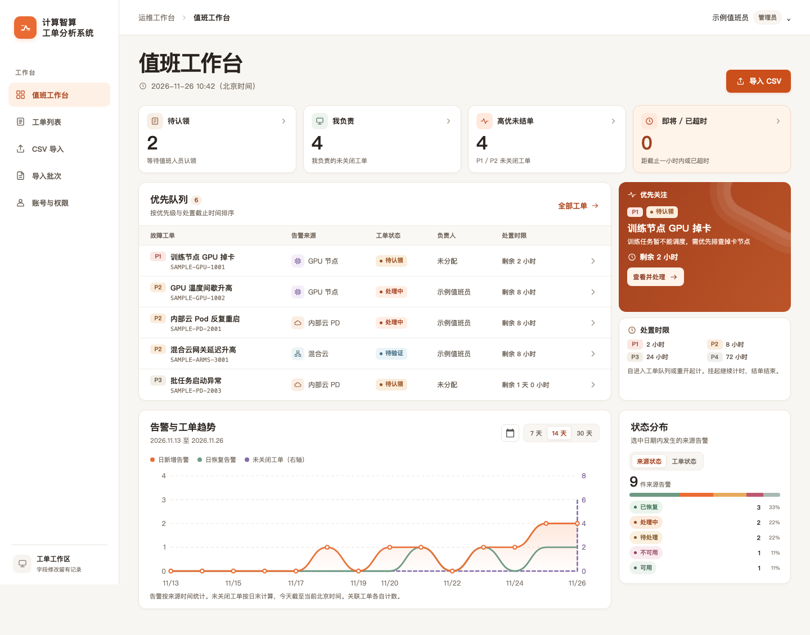
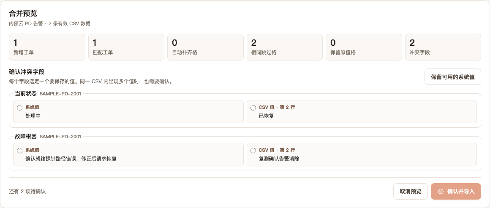
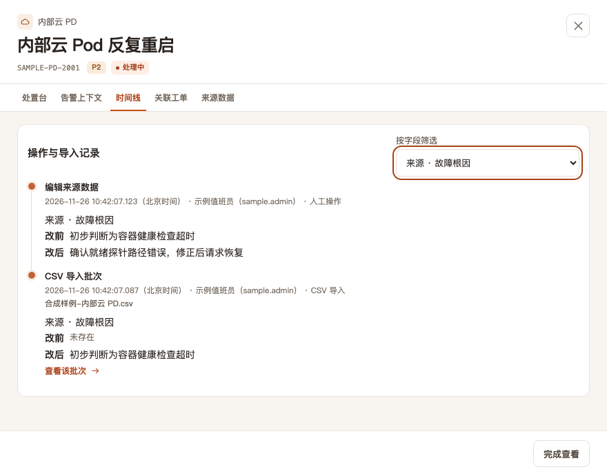
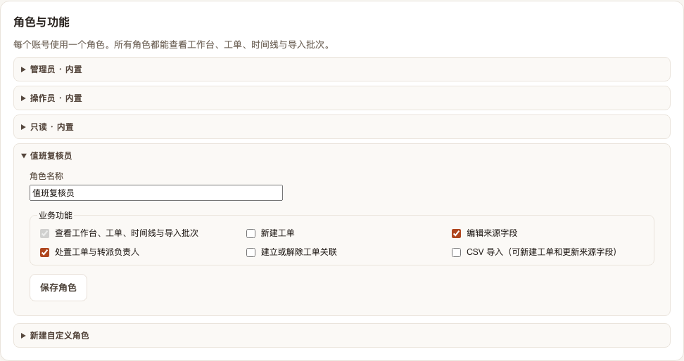

# 计算智算工单分析系统

面向云平台值班团队的工单工作台。把内部云 PD、混合云 ARMS 和 GPU 节点告警汇总为工单，在一个界面完成分派、处置、复测和回查。

[界面与特性](#界面与特性) · [依赖](#依赖) · [部署与运维](docs/deployment.md) · [下载 Release](https://github.com/underthedeepsea/incident-desk/releases/latest)



截图使用隔离环境的合成工单和示例账号。

## 界面与特性

### 值班队列与工单处置

工作台集中显示待认领、我负责、高优未结单及即将或已超时的工单。列表可按来源、工单状态和关键词检索。工单支持认领、转派、挂起、提交验证、结单和重开，也可关联相关告警工单。来源告警的恢复状态与工单的处置状态独立记录。

### CSV 和 Excel 导入与冲突复核

支持 UTF-8 CSV 和 Excel `.xlsx`，沿用内部云 PD、混合云 ARMS 和 GPU 节点的原有表头与字段。Excel 有多张数据工作表时，可选择其中一张预览。提交前可以查看新增、匹配、补齐和冲突数量，并逐字段选择系统值或表格值。工单和批次在同一事务保存，批次记录导入人、文件、工作表、冲突选项和原表格行号。[导入说明](docs/deployment.md#导入告警表格)



### 字段级审计

在「工单详情 → 时间线」按字段筛选，可查看编辑账号、时间、变更来源、改前值和改后值。时间线也记录认领、状态流转和关联等操作，可跳到相应导入批次。



### 功能级 RBAC

管理员从左侧「账号与权限」管理账号和角色。自定义角色可分别授予新建工单、编辑来源字段、处置与转派、建立或解除关联、表格导入。服务器对每项写操作校验权限，调整业务权限后，受影响账号需重新登录。

| 内置角色 | 默认权限 |
| --- | --- |
| 管理员 | 全部业务功能，以及账号和角色管理 |
| 操作员 | 查看、新建、编辑、处置、关联和表格导入 |
| 只读 | 查看工作台、工单、时间线和导入批次 |



## 依赖

| 用途 | 所需环境 |
| --- | --- |
| 应用运行 | **Node.js 24 LTS**，使用内置 `node:sqlite`。XLSX 读取依赖 SheetJS CE、saxes 和 yauzl，版本由 `package-lock.json` 锁定。需要可写数据目录，以及与 `PUBLIC_ORIGIN` 匹配的 HTTPS 入口。 |
| 源码构建镜像 | Docker 或兼容的 OCI 镜像构建工具。构建时，[Dockerfile](Dockerfile) 需要访问 npm Registry 和 SheetJS CDN 以安装锁定依赖。 |
| Kubernetes 部署 | 支持 Kustomize 的 `kubectl`、可供集群拉取的镜像、块存储 CSI 与 StorageClass，以及 Ingress 控制器和 TLS Secret。 |
| 本地接口测试 | Node.js 24 LTS、OpenSSL。测试会启动临时回环 HTTPS 服务和隔离 SQLite 库。 |
| 本地浏览器测试 | 上述测试环境，再加 Playwright 和 Chromium。 |

## 部署与存储

1. 从 `main` 获取当前源码，或下载所需版本的 [Release](https://github.com/underthedeepsea/incident-desk/releases)，用 Dockerfile 构建镜像。
2. 根据[部署与运维指南](docs/deployment.md)填写镜像、HTTPS 域名、Ingress class、TLS Secret 和 StorageClass，然后应用清单。
3. 通过标准输入创建首位管理员，再访问 HTTPS 入口。

Kubernetes 模板使用单副本 Deployment，将整个 `/data` 挂到 PVC。SQLite 主库位于 `/data/workspace.sqlite3`，账号、工单、角色和审计一并持久化。备份工具支持在线导出一致快照和空卷恢复。 [备份与恢复命令](docs/deployment.md#在线备份重启和恢复)

## 本地验证

```bash
npm ci --omit=dev --ignore-scripts
node --test test/production.test.cjs test/rbac.test.cjs test/xlsx-import.test.cjs
```

浏览器测试使用已安装的 Playwright 和 Chromium。Playwright 可以由 Node.js 加载、且默认 Chromium 已安装时，可省略路径变量。

```bash
PLAYWRIGHT_MODULE=/path/to/playwright CHROMIUM_EXECUTABLE=/path/to/chromium \
  node --test test/browser.test.cjs
kubectl kustomize k8s
```
